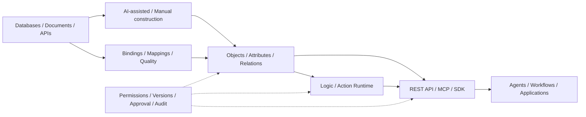

<div align="center">

# 元枢本体 · Yuanshu Ontology

**A runnable ontology platform for enterprise AI**

Turn business knowledge into objects and relations, connect live data, and expose query, calculation, and execution capabilities to applications and AI agents.

**Map the Business · Embody the Capability · Close the Intelligence Loop**

[中文](README.md) · [English](README.en.md)


[Interface](#interface) · [Quick Start](#quick-start) · [Usage Guide](docs/usage.en.md) · [Development and Contributions](#development-and-contributions)

</div>

## Overview

Yuanshu organizes knowledge from databases, business documents, rules, functions, and system APIs into shared business semantics. Objects and relations describe business structure, data bindings connect business facts, Logic and Action provide calculation and execution, and published versions give applications and agents a traceable business context.

Start with documents or data assets, let AI propose objects, attributes, and relations, then map, review, and validate them against real data before publication. You can also model manually or import an existing model.

The platform is intended for teams building shared business semantics, agents grounded in business data, and reusable rules and operations. AI construction and conversations require a configured model service. Manual modeling, version management, and local data connections can be explored independently.

## Capabilities

| Capability | What you can do |
| --- | --- |
| **Ontology construction** | Build manually, from templates, documents, or data assets; review AI suggestions through object definition, mapping, final review, validation, and publication |
| **Visual modeling** | Manage objects, attributes, relations, shared attributes and references; explore the ontology graph; use Protégé-style and WebVOWL editing views |
| **Data grounding** | Connect primary data, enrichment data, and document evidence through `ObjectBinding`; manage mappings, transformations, quality rules, and lineage |
| **Logic / Action** | Expression, SQL, and Python functions; API calls, SQL execution, attribute updates, notifications, function calls, and custom scripts |
| **Agents / business skills** | Compose instructions, object scopes, tools, and references; test and publish fixed versions; debug conversations, inspect tool traces, and confirm actions |
| **Workflow orchestration** | Visual DAGs, conditional branches, parameter mappings, Logic / Action / Agent nodes, and execution traces |
| **Publishing and governance** | Drafts, approval, version snapshots, comparison, impact analysis, and rollback requests; RBAC, JWT, OIDC, encrypted credentials, and execution audit |
| **Application integration** | Ontology REST APIs, an MCP HTTP JSON-RPC tool endpoint, and TypeScript / Python SDKs generated from published ontologies |

Connectors include SQLite, MySQL, PostgreSQL, SQL Server, Oracle, S3 / MinIO, FTP / SFTP, REST APIs, and Kafka. Kafka currently supports connection probes, topic metadata, and bounded message sampling. Model exchange supports OWL / RDF, Turtle, JSON, and Excel; see the [usage guide](docs/usage.en.md) for entry points and formats.

## Interface

These screenshots come from the current source running in a separate equipment maintenance demo environment. The Agent and skill examples show draft configuration; conversation debugging requires actual model credentials.

### Ontology graph

Explore equipment, sensors, work orders, and technicians as business objects and relations.


<details>
<summary>View data assets, publishing, and the Agent workbench</summary>

### Data assets

Register business tables and documents, inspect their schemas, and make them available for ontology mappings.


### Publishing

Inspect objects, relations, and logic in a published version, and manage subsequent changes and approvals.


### Agent workbench

Pin an ontology version, scope accessible objects, and configure business capabilities. The conversation panel provides a place to test the configuration.


</details>

See the [usage guide](docs/usage.en.md) for navigation and the [screenshot notes](docs/screenshots.md) for the example and update process.

## Architecture



The frontend uses Vue 3, TypeScript, Vite, Pinia, and Ant Design Vue, with d3-force and Vue Flow for graph and workflow visualization. The backend uses FastAPI, SQLAlchemy, and Pydantic. Metadata defaults to SQLite; MySQL is also configurable. Code workspaces integrate code-server.

AI interprets inputs and proposes candidates. Programs validate structure, check permissions, and execute operations. Users confirm business decisions during review, publication, and action authorization.

## Quick Start

### Requirements

- **Python 3.11+**.
- **Node.js 22.13+ (22.x) or 24+, npm**. Locked dependencies also support Node.js 20.19+ (20.x); these requirements cover both Vite 8 and ESLint 10.
- The full startup scripts use **code-server**. On Linux / macOS, the script attempts an online installation if it is missing. On Windows, install it beforehand and make it available on PATH.
- Linux / macOS scripts also require `curl` and `lsof`. Legacy `.doc / .xls / .ppt` ingestion requires LibreOffice `soffice`.

A local setup can use SQLite without deploying Redis, Neo4j, or object storage first. Configure external databases, storage, and AI services when you need them.

### 1. Clone and install dependencies

Linux / macOS:

```bash
git clone https://github.com/fuyuxiang/ontology.git
cd ontology

python3 -m venv backend/venv
backend/venv/bin/python -m pip install -r backend/requirements.txt

npm --prefix frontend ci
cp backend/.env.example .env
```

Windows PowerShell:

```powershell
git clone https://github.com/fuyuxiang/ontology.git
cd ontology

py -3 -m venv backend\venv
.\backend\venv\Scripts\python.exe -m pip install -r backend\requirements.txt

npm --prefix frontend ci
Copy-Item backend\.env.example .env
```

### 2. Configure the root `.env`

Edit the copied file and set at least:

```env
DATABASE_URL=sqlite:///./ontology.db

# Use a randomly generated secret
SECRET_KEY=replace-with-a-random-secret

# Required when admin is first created: >= 8 characters, uppercase, lowercase, digits
ADMIN_INITIAL_PASSWORD=replace-with-your-own-password

CORS_ORIGINS=http://localhost:5177,http://127.0.0.1:5177

# Set these before using AI construction or conversations
LLM_BASE_URL=https://your-llm-endpoint/v1
LLM_API_KEY=
LLM_MODEL=your-model-name
```

Sign in as `admin` with your configured `ADMIN_INITIAL_PASSWORD`. There is no default administrator password. Startup configuration does not reset existing passwords.

The full template is [backend/.env.example](backend/.env.example). Workspaces and local SQLite source files default to the repository's `workspace/` and `local-data/` directories. Set a stable `CREDENTIAL_ENCRYPTION_KEY` when storing external connection credentials; see [configuration and deployment](docs/usage.en.md#configuration-and-deployment).

### 3. Start and access the services

Linux / macOS:

```bash
./start.sh
```

Windows:

```powershell
.\start.bat
```

| Service | Default address |
| --- | --- |
| Web UI | http://localhost:5177 |
| API documentation | http://localhost:8001/docs |
| Health check | http://localhost:8001/api/health |
| MCP tool endpoint | `POST http://localhost:8001/api/v1/mcp` |
| Code editor | http://localhost:8443 |

First startup creates tables, runs migrations, and creates the administrator. Set the editor password with `CODE_SERVER_PASSWORD`, or retrieve it from the locally generated `.code-server-password` file.

Change ports in the root `.env` with `BACKEND_PORT`, `FRONTEND_PORT`, and `CODE_SERVER_PORT`. Logs are written to `backend.log`, `frontend.log`, and `code-server.log`. Stop with `./stop.sh`, or `.\stop.bat` on Windows.

These scripts are for local development and evaluation. Set `SKIP_DEPENDENCY_INSTALL=1` to skip installation when dependencies are already available. See the [usage guide](docs/usage.en.md#configuration-and-deployment) for deployment settings and service access.

## First Workflow

1. Sign in, configure a business data source in **Data Connections**, then register tables or documents in **Asset Catalog**.
2. Create an ontology in **Ontologies** and select manual, template, document, or asset construction.
3. Complete **Object definition → Data mapping → Final review → Validation and publication**, checking primary keys, field mappings, and relations.
4. Add business functions and actions, associating calculation and operations with business objects.
5. Write instructions, select dependencies, and run tests in **Business Skills**; publish a reusable skill version.
6. In **Agent Applications**, pin published ontology and skill versions, configure the object scope and model, test, then publish and integrate through the API.

Agent actions use simulation by default. In confirmation mode, business writes require authorization from a logged-in user with the relevant permissions. Public Agent APIs cannot confirm writes on that user's behalf. See [publication and execution rules](docs/usage.en.md).

## Development and Contributions

The API and frontend can run separately without the code editor. Complete dependency installation and `.env` configuration first.

```bash
# Terminal 1: backend
cd backend
venv/bin/python -m uvicorn app.main:app --host 127.0.0.1 --port 8001 --reload
```

```bash
# Terminal 2: frontend
cd frontend
npm run dev
```

On Windows, use `venv\Scripts\python.exe`. See the [frontend guide](frontend/README.md) for proxy configuration, routes, and directories.

Run checks appropriate to your change:

```bash
# Backend regressions: isolated databases, workspaces, and local protocol fixtures
cd backend
venv/bin/python -m pip install -r requirements-dev.txt
venv/bin/python -m pytest -q

# Frontend state regressions, type checks, build, and lint
cd ../frontend
npm run test:ui-state
npm run build
npm run lint
```

| Directory | Responsibility |
| --- | --- |
| [backend/app/api/v1](backend/app/api/v1) | Ontology, publication, grounding, Agent, skill, and service APIs |
| [backend/app/services](backend/app/services) | Construction, execution, versions, agents, and MCP tools |
| [backend/app/connectors](backend/app/connectors) | Database, object storage, file transfer, and API connectors |
| [backend/tests](backend/tests) | Backend regression and acceptance scripts |
| [frontend/src](frontend/src) | Views, components, routes, state, and API clients |
| [docs](docs) | Usage documentation and interface assets |
| [scripts](scripts) | Process management; workspace configuration is in [code-server](code-server) |

Use [Issues](https://github.com/fuyuxiang/ontology/issues) to report problems and discuss designs, and [Pull Requests](https://github.com/fuyuxiang/ontology/pulls) to propose changes. Describe the problem, behavior changes, and validation in your PR. Update documentation for new capabilities and keep both languages aligned.

## License

The original README declared the MIT license, but this checkout does not yet contain a `LICENSE` file. Copyright information and the full license text need to be added before a formal public release.
