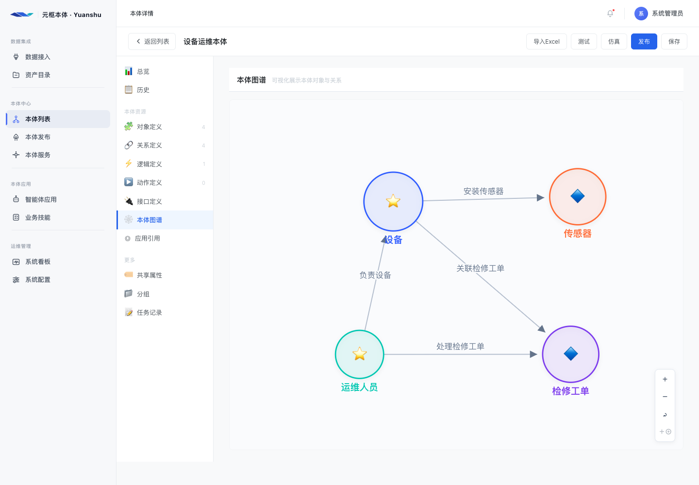
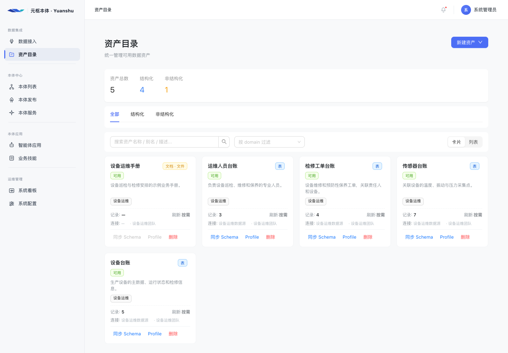
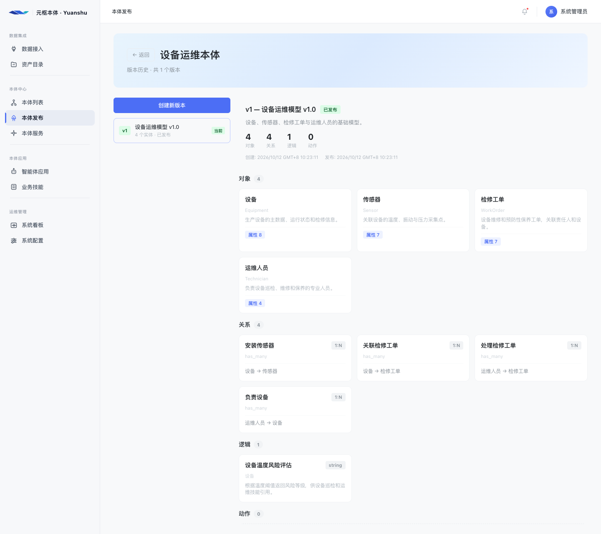
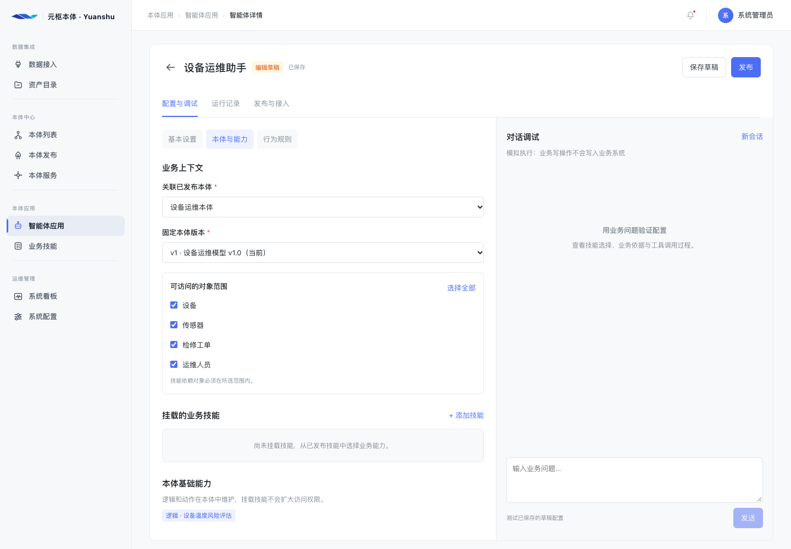
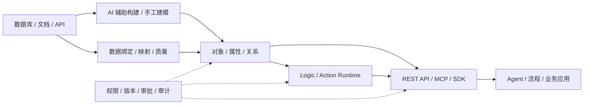

<div align="center">

# 元枢本体 · Yuanshu Ontology

**面向企业 AI 的可运行本体平台**

将业务知识组织为对象与关系，连接真实数据，并供应用与 AI Agent 查询、计算和执行。

**业务成图 · 能力入体 · 智能成环**

[中文](README.md) · [English](README.en.md)


[系统界面](#系统界面) · [快速开始](#快速开始) · [使用指南](docs/usage.md) · [开发与贡献](#开发与贡献)

</div>

## 项目简介

元枢把分散在数据库、业务文档、规则、函数和系统接口中的知识，组织为统一的业务语义。对象与关系描述业务结构，数据绑定连接业务事实，Logic 和 Action 提供计算与执行能力，发布版本则为应用与 Agent 提供可追踪的业务上下文。

你可以从文档或数据资产开始，让 AI 提取候选对象、属性与关系，再经过映射、人工审核和真实数据验证，形成可发布的本体；也可以手工建模或导入已有模型。

适合需要统一业务语义、构建基于业务数据的 Agent，或复用企业规则与执行能力的团队。AI 构建与对话运行需要配置可用模型服务；手工建模、版本管理和本地数据接入可先独立体验。

## 核心能力

| 能力 | 可以完成的工作 |
| --- | --- |
| **本体构建** | 手动、模板、文档和数据资产构建；AI 提取建议，逐步完成对象定义、数据映射、最终审核与验证发布 |
| **可视化建模** | 管理对象、属性、关系、共享属性与引用；查看本体图谱；提供 Protégé 风格和 WebVOWL 编辑视图 |
| **数据接地** | 通过 `ObjectBinding` 连接主数据、补充数据和文档证据；维护字段映射、转换、质量规则与血缘 |
| **Logic / Action** | Expression、SQL、Python 函数；接口调用、SQL 执行、属性修改、通知、函数调用和自定义脚本行动 |
| **Agent / 业务技能** | 组织操作指引、对象范围、工具与参考资料；测试和发布固定版本；对话调试、工具过程与行动确认 |
| **流程编排** | 可视化 DAG、条件分支、节点参数映射及 Logic / Action / Agent 节点，记录执行过程 |
| **发布与治理** | 草稿、审批、版本快照、比较、影响分析与回滚申请；RBAC、JWT、OIDC、凭据加密与执行审计 |
| **应用接入** | 本体 REST API、MCP HTTP JSON-RPC 工具端点，以及根据已发布本体生成的 TypeScript / Python SDK |

数据连接器包括 SQLite、MySQL、PostgreSQL、SQL Server、Oracle、S3 / MinIO、FTP / SFTP、REST API 和 Kafka。Kafka 当前用于连接探测、主题元数据与有限消息采样。模型交换支持 OWL / RDF、Turtle、JSON 和 Excel，具体入口与格式见[使用指南](docs/usage.md)。

## 系统界面

以下页面来自当前源码运行的独立设备运维演示环境。Agent 和技能示例展示草稿配置，对话调试需配置实际模型凭证。

### 本体图谱

把设备、传感器、检修工单和人员组织为可浏览的对象与关系。



<details>
<summary>查看数据资产、发布管理与 Agent 工作台</summary>

### 数据资产

统一登记业务数据表与文档，查看字段结构，并为本体映射提供数据来源。



### 发布管理

查看已发布版本的对象、关系与逻辑快照，管理后续变更与审批。



### Agent 工作台

固定本体版本、限定对象范围，并配置业务能力；右侧用于对话调试。



</details>

页面入口与操作顺序见[使用指南](docs/usage.md)，截图场景与更新方式见[截图说明](docs/screenshots.md)。

## 系统架构



前端使用 Vue 3、TypeScript、Vite、Pinia 和 Ant Design Vue；图谱与流程使用 d3-force 和 Vue Flow。后端使用 FastAPI、SQLAlchemy 与 Pydantic，元数据默认存储在 SQLite，也可配置 MySQL。代码工作区集成 code-server。

AI 负责理解与生成候选结果，程序负责结构校验、权限检查和执行，用户在审核发布与行动授权时确认关键业务决策。

## 快速开始

### 环境要求

- **Python 3.11+**。
- **Node.js 22.13+（22.x）或 24+，npm**。当前锁定依赖也支持 Node.js 20.19+（20.x）；版本要求同时考虑 Vite 8 与 ESLint 10。
- 完整启动脚本使用 **code-server**。Linux / macOS 未安装时脚本会尝试联网安装；Windows 需提前安装并确保命令在 PATH 中。
- Linux / macOS 启动脚本还需 `curl`、`lsof`。导入旧版 `.doc / .xls / .ppt` 文件时另需 LibreOffice `soffice`。

本地体验可以使用 SQLite，无需先部署 Redis、Neo4j 或对象存储。外部数据库、存储与 AI 能力使用时再配置对应服务。

### 1. 获取源码并安装依赖

Linux / macOS：

```bash
git clone https://github.com/fuyuxiang/ontology.git
cd ontology

python3 -m venv backend/venv
backend/venv/bin/python -m pip install -r backend/requirements.txt

npm --prefix frontend ci
cp backend/.env.example .env
```

Windows PowerShell：

```powershell
git clone https://github.com/fuyuxiang/ontology.git
cd ontology

py -3 -m venv backend\venv
.\backend\venv\Scripts\python.exe -m pip install -r backend\requirements.txt

npm --prefix frontend ci
Copy-Item backend\.env.example .env
```

### 2. 配置根目录 `.env`

修改刚复制的 `.env`，至少设置以下内容：

```env
DATABASE_URL=sqlite:///./ontology.db

# 使用随机生成的密钥
SECRET_KEY=replace-with-a-random-secret

# 首次创建 admin 必填：至少 8 位，包含大写、小写字母和数字
ADMIN_INITIAL_PASSWORD=replace-with-your-own-password

CORS_ORIGINS=http://localhost:5177,http://127.0.0.1:5177

# 使用 AI 构建与对话时填写
LLM_BASE_URL=https://your-llm-endpoint/v1
LLM_API_KEY=
LLM_MODEL=your-model-name
```

管理员用户名为 `admin`，密码为你设置的 `ADMIN_INITIAL_PASSWORD`。系统没有默认管理员密码，启动配置也不会重置已有账号的密码。

完整变量模板见 [backend/.env.example](backend/.env.example)。工作区与本地 SQLite 数据源目录默认使用仓库下的 `workspace/` 和 `local-data/`。需要保存外部连接凭据时，建议设置稳定的 `CREDENTIAL_ENCRYPTION_KEY`，详见[使用指南](docs/usage.md#配置与部署)。

### 3. 启动与访问

Linux / macOS：

```bash
./start.sh
```

Windows：

```powershell
.\start.bat
```

| 服务 | 默认地址 |
| --- | --- |
| Web 页面 | http://localhost:5177 |
| API 文档 | http://localhost:8001/docs |
| 健康检查 | http://localhost:8001/api/health |
| MCP 工具端点 | `POST http://localhost:8001/api/v1/mcp` |
| 代码编辑器 | http://localhost:8443 |

首次启动自动建表、迁移和创建管理员。编辑器密码由 `CODE_SERVER_PASSWORD` 指定，或保存到首次启动生成的 `.code-server-password` 文件。

端口可在根目录 `.env` 中通过 `BACKEND_PORT`、`FRONTEND_PORT`、`CODE_SERVER_PORT` 修改。启动日志为 `backend.log`、`frontend.log` 和 `code-server.log`。停止服务使用 `./stop.sh`，Windows 使用 `.\stop.bat`。

启动脚本用于本地开发与体验。已有依赖可设置 `SKIP_DEPENDENCY_INSTALL=1` 跳过安装；部署配置和服务访问范围见[使用指南](docs/usage.md#配置与部署)。

## 第一次使用

1. 登录后进入「数据接入」，配置业务数据源；在「资产目录」登记表或文档。
2. 在「本体列表」创建本体，选择手动、模板、文档或资产构建。
3. 按「对象定义 → 数据映射 → 最终审核 → 验证发布」完成建模，检查主键、字段映射与关系。
4. 添加业务函数和行动，将计算与操作绑定到业务对象。
5. 在「业务技能」编写操作指引、选择依赖并测试，发布可复用的技能版本。
6. 在「智能体应用」固定已发布本体与技能版本，配置对象范围和模型；调试通过后发布，再通过 API 接入应用。

Agent 行动默认模拟执行。确认模式下，业务写入需要有权限的登录用户授权；公开 Agent 接口不能代替登录用户确认写操作。详细行为见[发布与执行规则](docs/usage.md)。

## 开发与贡献

仅运行 API 与前端时，可以分别启动，不必先启动代码编辑器。先完成上述依赖安装与 `.env` 配置。

```bash
# 终端 1：后端
cd backend
venv/bin/python -m uvicorn app.main:app --host 127.0.0.1 --port 8001 --reload
```

```bash
# 终端 2：前端
cd frontend
npm run dev
```

Windows 将 Python 命令替换为 `venv\Scripts\python.exe`。前端代理、页面路由与目录见[前端开发指南](frontend/README.md)。

提交前按改动范围运行：

```bash
# 后端回归：使用独立数据库、工作区和本地协议测试数据
cd backend
venv/bin/python -m pip install -r requirements-dev.txt
venv/bin/python -m pytest -q

# 前端状态回归、类型检查、构建及静态检查
cd ../frontend
npm run test:ui-state
npm run build
npm run lint
```

| 目录 | 职责 |
| --- | --- |
| [backend/app/api/v1](backend/app/api/v1) | 本体、发布、数据接地、Agent、技能与服务接口 |
| [backend/app/services](backend/app/services) | 建模、执行、版本、Agent 与 MCP 工具实现 |
| [backend/app/connectors](backend/app/connectors) | 数据源、对象存储、文件传输和 API 连接器 |
| [backend/tests](backend/tests) | 后端回归与验收脚本 |
| [frontend/src](frontend/src) | 页面、组件、路由、状态与 API 客户端 |
| [docs](docs) | 使用说明与界面展示资源 |
| [scripts](scripts) | 启停进程管理；工作区配置位于 [code-server](code-server) |

欢迎通过 [Issues](https://github.com/fuyuxiang/ontology/issues) 报告问题、讨论设计，通过 [Pull Requests](https://github.com/fuyuxiang/ontology/pulls) 提交改进。PR 请说明问题、行为变化与验证结果；涉及新能力时同步更新文档，两种语言保持一致。

## 许可证

项目原 README 声明采用 MIT 许可证，但当前仓库尚未包含 `LICENSE` 文件。正式对外发布前需补齐版权信息与许可证全文。
